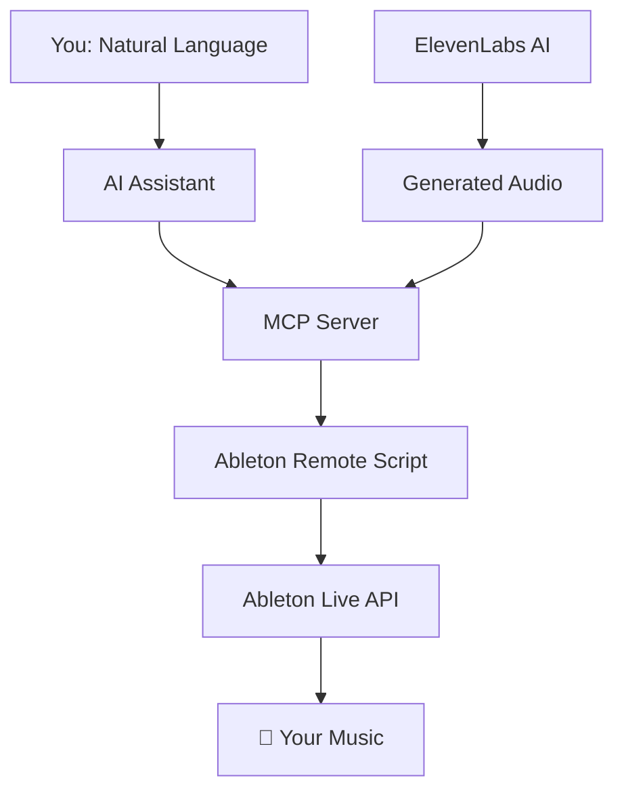

# Ableton MCP Extended
**Control Ableton Live using natural language via AI assistants like Claude or Cursor. This project provides a robust Model Context Protocol (MCP) server that translates natural language commands into precise actions within your Ableton Live session.**

[](https://opensource.org/licenses/MIT)
[](https://www.python.org/downloads/)
[](https://www.ableton.com/)

---

Video demonstration: https://www.youtube.com/watch?v=7ZKPIrJuuKk

This tool is designed for producers, developers, and AI enthusiasts who want to streamline their music production workflow, experiment with generative music, and build custom integrations with Ableton Live.

**You can transform this conversation:**
```
👤 "Create a brief minimalist/neo-classical composition in a style similar to Ólafur Arnalds'. (Ableton MCP) / I've loaded four MIDI tracks called "Noire" and "Noire (2) ["Emotional Felt" presets], "Noire (2) ["Reversed Felt" preset, for ambient background], and "Noire (3) ["Ethereal Felt" preset, also for ambient background]. All loaded with nice piano instruments. You have also a MIDI track called "Strings" with a nice string ensemble instrument loaded. Feel free to add new instruments and effects, if pertinent."
🤖 "Creating MIDI clips... Adding effects... Done!"
👤 "Then, use ElevenLabs MCP to create a spoken-word audio clip (default voice and settings) with a relevant poem in the style of “Jim Morrison” to accompany the composition."  
🤖 "Generating poem... Transforming it into speech... Importing it into your session... Done!"
```

**Into this music production session**:

https://github.com/user-attachments/assets/d6ef2de5-bdeb-4097-acc0-67d70f7f85b3

---

## Key Features

This project provides comprehensive, programmatic control over the Ableton Live environment.

* **Session and Transport Control:**
    * Start and stop playback.
    * Get session info, including tempo, time signature, and track count.
    * Manage scenes: create, delete, rename, and fire.

* **Track Management:**
    * Create, rename, and get detailed information for MIDI and audio tracks.
    * Control track properties: volume, panning, mute, solo, and arm.
    * Set a track's input type/channel and monitoring (In/Auto/Off) by the names Live shows.
    * Address tracks by number, name, or return letter, with an `expect_name` guard so a write fails instead of hitting the wrong track.
    * Change several tracks' mute/solo/arm/input/monitoring in one validated batch, with a dry run.
    * Check what is armed and what would record before recording (`get_recording_status`), and list every track compactly (`list_tracks`).
    * Manage track grouping and folding states.

* **MIDI Clip and Note Manipulation:**
    * Create and name MIDI clips with specified lengths.
    * Add, delete, transpose, and quantize notes within clips.
    * Perform batch edits on multiple notes in a single operation.
    * Adjust clip loop parameters and follow actions.

* **Device and Parameter Control:**
    * Load instruments and effects from Ableton's browser by URI.
    * Get a full list of parameters for any device on a track.
    * Set and batch-set device parameters using normalized values (0.0 to 1.0).

* **Automation and Envelopes:**
    * Add and clear automation points for any device parameter within a clip. [This feature isn't working perfectly yet.]
    * Get information about existing clip envelopes.

* **Browser Integration:**
    * Navigate and list items from Ableton's browser.
    * Load instruments, effects, and samples directly from a browser path or URI.
    * Import audio files directly into audio tracks or clip slots.

* **Exporting Audio and Video (macOS):**
    * Render the Main output to WAV, AIFF, FLAC or MP3 with `export_audio`, choosing sample rate, bit depth, normalize and the range (whole Arrangement, loop brace, or current selection).
    * Render the Arrangement's video along with the audio with `export_video`.
    * These drive Live's Export Audio/Video dialog through macOS UI scripting. See [Exporting audio and video](#exporting-audio-and-video-macos) for the requirements.

* **Voice & Audio Generation** 
    * Text-to-Speech Integration: Generate narration, vocal samples, or spoken elements through ElevenLabs MCP [included].
    * Custom Voice Creation: Clone voices for unique character in your tracks  
    * Sound Effects: Create custom SFX with AI
    * Direct Import: Generated audio appears instantly in your Ableton session

* **Extensible Framework for Custom Tools**
    * Example: XY Mouse Controller: Demonstrates creating custom Ableton controllers with the MCP framework
    * Ultra-Low Latency: High-performance UDP protocol enables responsive real-time control
    * Unlimited Possibilities: Build your own custom tools and controllers for Ableton Live

---

##  Quick Start (5 Minutes)

### Prerequisites
- Ableton Live 11+ (any edition)
- Python 3.10 or higher
- Claude Desktop or Cursor IDE

### 1. **Get the Code**
```bash
git clone https://github.com/uisato/ableton-mcp-extended.git
cd ableton-mcp-extended
pip install -e .
```

### 2. **Install Ableton Script**
1. Find your Ableton User Library Remote Scripts folder:
   - **Windows**: `C:\Users\[You]\Documents\Ableton\User Library\Remote Scripts\`
   - **Mac**: `~/Music/Ableton/User Library/Remote Scripts/`
2. Create folder: `AbletonMCP`
3. Copy `AbletonMCP_Remote_Script/__init__.py` into this folder

### 3. **Configure Ableton**
1. Open Ableton Live
2. Go to **Preferences** → **Link, Tempo & MIDI**
3. Set **Control Surface** to "AbletonMCP"
4. Set Input/Output to "None"

### 4. **Connect AI Assistant**

**For Claude Desktop:**
```json
{
  "mcpServers": {
    "AbletonMCP": {
      "command": "python",
      "args": ["C:/path/to/ableton-mcp-extended/MCP_Server/server.py"]
    }
  }
}
```

**For Cursor:**
Add MCP server in Settings → MCP with the same path.

### 5. **Start Creating!** 
Open your AI assistant and try:
- *"Create a new MIDI track with a piano"*
- *"Add a simple drum beat"*
- *"What tracks do I currently have?"*

---

## How It Works



1. You issue a command in plain English to your AI assistant (e.g., "Create a new MIDI track and name it 'Bass'").
2. The AI Assistant understands the intent and calls the appropriate tool from the MCP server.
3. The MCP Server (server.py) receives the tool call and constructs a specific JSON command.
4. The Ableton Remote Script (__init__.py), running inside Live, receives the JSON command via a socket connection.
5. The Remote Script executes the command using the official Ableton Live API, making the change in your session instantly.

---

## Advanced Features

<details>
<summary><strong>🚀 High-Performance Mode (UDP Server)</strong></summary>


For real-time parameter control with ultra-low latency:

```bash
# Install the hybrid server
cp -r Ableton-MCP_hybrid-server/AbletonMCP_UDP/ ~/Remote\ Scripts/AbletonMCP_UDP/

# Try the XY Mouse Controller example
cd experimental_tools/xy_mouse_controller
python mouse_parameter_controller_udp.py
```

This demonstrates how to build:
- Custom real-time controllers for Ableton
- Expressive performance tools
- Interactive music applications
</details>

<details>
<summary><strong>🎤 ElevenLabs Voice Integration</strong></summary>


This repository can be integrated with other MCP servers, such as one for ElevenLabs, to generate and import audio directly into your project.

Set up the ElevenLabs MCP server according to its instructions.

Update your AI assistant's config to include both servers.

Example mcp-config.json:

```json
{
  "mcpServers": {
    "AbletonMCP": {
      "command": "python",
      "args": ["/path/to/ableton-mcp-extended/server.py"]
    },
    "ElevenLabs": {
      "command": "python",
      "args": ["/path/to/elevenlabs_mcp/server.py"],
      "env": {
        "ELEVENLABS_API_KEY": "your-api-key-here"
      }
    }
  }
}
```

</details>

---

## Exporting Audio and Video (macOS)

Live's Remote Script API has no way to start an export, so `export_audio` and `export_video` work through Live's UI instead. They bring Live to the front, open **File > Export Audio/Video**, set the dialog, fill in the macOS Save panel, wait for the render, and then check the file before they report success.

Requirements:

- macOS, with Ableton Live running. Live must not have another dialog open. The tools find the Export dialog's controls by the accessibility names Live 12 gives them, so an older Live may not work.
- The app that runs the MCP server (Claude Desktop, your terminal, Cursor) needs **Accessibility** permission (System Settings > Privacy & Security > Accessibility). It also needs permission to control **System Events** (Automation). macOS asks for this the first time.
- Leave the mouse and keyboard alone until the tool returns. Live is in front during the export, and the call blocks until the render finishes, which can take minutes.

What gets set:

| Parameter | Values | Default |
| --- | --- | --- |
| `output_path` | Absolute file path. The folder must exist, and the extension is optional. | required |
| `format` | `wav`, `aiff`, `flac`, `mp3` (CBR 320) | `wav` |
| `sample_rate` | 22050, 32000, 44100, 48000, 88200, 96000, 176400, 192000 | 44100 |
| `bit_depth` | 16, 24, 32 (PCM only) | 24 |
| `render_range` | `arrangement` (bar 1 to the end of the last clip), `loop` (the loop brace), `selection` (whatever Live pre-fills) | `arrangement` |
| `normalize` | true / false | false |
| `overwrite` | Replace an existing file | false |
| `render_timeout` | Seconds to wait for the render to finish | 900 (`export_video`: 1800) |

Rendered Track is always set to Main. `arrangement` moves the loop brace over the whole Arrangement to select it, and puts the brace back afterwards. `arrangement` and `loop` also switch Live to the Arrangement View and leave it there. Live keeps the dialog settings these tools choose for your next manual export. Options the tools don't expose (dither, Render as Loop, Convert to Mono, Create Analysis File, video encoder) are left as they are.

Live renders what is playing, so `arrangement` and `loop` refuse to run while Session clips override the Arrangement (the Back to Arrangement button is lit). Click it first, or use `selection` to render what you hear.

The reply is JSON. `ok` is true only when the output file exists and has stopped growing, and `afinfo` doesn't report a different sample rate or bit depth or, for `arrangement` and `loop`, a different length than the request. If `afinfo` can't be run or leaves one of those values out, `ok` stays true and `warnings` says what wasn't checked. A failure comes back as `ok: false` with the reason in `error`. That covers a dialog that never opened, a control that wouldn't change, an unwritable folder, an existing file, a render timeout, or an error message Live showed (quoted verbatim in `dialog_text`). The reply also lists every UI step it took.

The tools don't read Render Start and Render Length back from the dialog, so `render_range` in the reply is the range you asked for, and the file's length is the only check on it. `rendered_seconds` is the length `afinfo` reports. `expected_seconds` is the range's length in beats at the Set's current tempo, and `length_verified` is true when the two agree to within half a second. If they don't, the file stays where it was written and the reply is `ok: false`. That check assumes one tempo, so a Set whose tempo changes inside the range fails it even when the file is right. `selection` has no expected length and is never length-verified.

`export_video` needs video clips in the Arrangement, because Live only enables Create Video when there are some. The video is written next to the audio file using the encoder already chosen in the dialog.

These tools can't run in CI. The unit tests stub out the UI scripting. A guarded manual check runs a real export against a scratch Set:

```bash
ABLETON_MCP_LIVE_TESTS=1 ABLETON_MCP_EXPORT_TESTS=1 \
    uv run --extra test python -m pytest -m integration tests/integration/test_live_export_live.py -s
```

---

## Components Overview

This project includes several specialized components:

### **Core MCP Server**
- Standard TCP communication for reliable AI control
- Extensive Ableton Live API integration
- Compatible with Claude Desktop, Cursor, and Gemini CLI.

### **Hybrid TCP/UDP Server** 
- High-performance real-time parameter control
- Ultra-low latency for live performance
- Perfect for controllers and interactive tools

### **ElevenLabs Integration**
- Professional text-to-speech generation
- Custom voice creation and cloning
- Direct import into Ableton sessions
- Real-time SFX generation

### **Experimental Tools & Examples**
- **XY Mouse Controller**: Example demonstrating how to build custom Ableton controllers
- **Extensible Framework**: Foundation for creating your own control interfaces
- **Proof of Concept**: Shows the power and flexibility of the MCP approach

---

## Documentation

- **[Installation Guide](INSTALLATION.md)** - Detailed setup instructions
- **[User Guide](README.md)** - What, which, and how  

### Running the tests

The unit tests stub out Ableton Live, so they run without it:

```bash
uv run --extra test python -m pytest --cov
```

`--cov` measures `MCP_Server` and `AbletonMCP_Remote_Script` and fails the run if total coverage drops below the `fail_under` value in `pyproject.toml`. Tests marked `integration` need a running Live instance and are skipped by default.

---

## Community & Support

- **GitHub Issues**: Bug reports and feature requests
- **Discussions**: Share your creations and get help

### **Share Your Creations**
Tag me with your AI-generated experiments! I love seeing what the community creates:

[YouTube](https://www.youtube.com/@uisato_) |
[Instagram](https://www.instagram.com/uisato_) |
[Patreon](https://www.patreon.com/c/uisato) |
[Website](https://www.uisato.art/) 

---

## What's Next

- **Fixing Automation Point Placement Bugs**
- ~**VST Plugin Support** - Control third-party plugins [Though it can be achieved throught the "Configure" parameter function]~ → Done!
- **Arrangement View** - Full timeline control
- **Hardware Integration** - Bridge MIDI controllers through AI
- **Advanced AI** - Smarter and better music understanding and generation

---

## License & Credits

This project is licensed under the MIT License - see [LICENSE](LICENSE) for details.

**Built with:**
- [Model Context Protocol](https://github.com/modelcontextprotocol) - AI integration framework
- [ElevenLabs API](https://elevenlabs.io) - Professional voice generation
- [Ableton Live](https://www.ableton.com) - Digital audio workstation

**Inspired by:** The original [ableton-mcp](https://github.com/ahujasid/ableton-mcp) project

---

<div align="center">

**Made with ❤️ for the music production community**

*If this project helps your creativity, consider giving it a ⭐ star!*

</div> 
