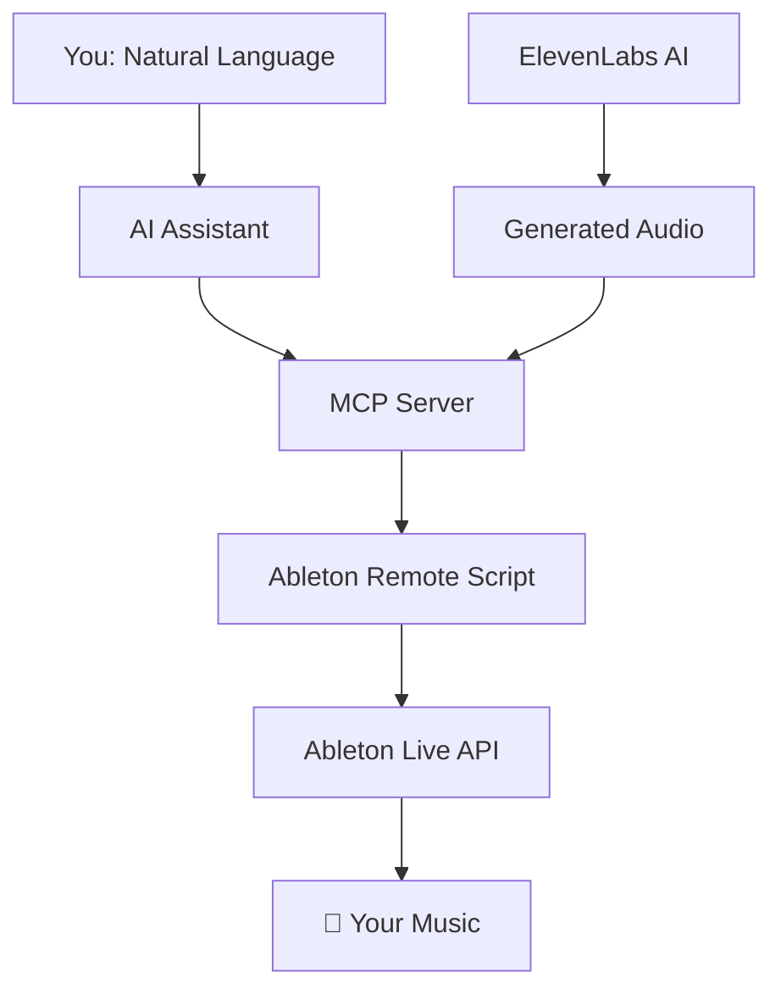

# Ableton MCP Extended
**Control Ableton Live using natural language via AI assistants like Claude or Cursor. This project provides a robust Model Context Protocol (MCP) server that translates natural language commands into precise actions within your Ableton Live session.**

[](https://opensource.org/licenses/MIT)
[](https://www.python.org/downloads/)
[](https://www.ableton.com/)

---

Video demonstration: https://www.youtube.com/watch?v=7ZKPIrJuuKk

This tool is designed for producers, developers, and AI enthusiasts who want to streamline their music production workflow, experiment with generative music, and build custom integrations with Ableton Live.

**You can transform this conversation:**
```
👤 "Create a brief minimalist/neo-classical composition in a style similar to Ólafur Arnalds'. (Ableton MCP) / I've loaded four MIDI tracks called "Noire" and "Noire (2) ["Emotional Felt" presets], "Noire (2) ["Reversed Felt" preset, for ambient background], and "Noire (3) ["Ethereal Felt" preset, also for ambient background]. All loaded with nice piano instruments. You have also a MIDI track called "Strings" with a nice string ensemble instrument loaded. Feel free to add new instruments and effects, if pertinent."
🤖 "Creating MIDI clips... Adding effects... Done!"
👤 "Then, use ElevenLabs MCP to create a spoken-word audio clip (default voice and settings) with a relevant poem in the style of “Jim Morrison” to accompany the composition."  
🤖 "Generating poem... Transforming it into speech... Importing it into your session... Done!"
```

**Into this music production session**:

https://github.com/user-attachments/assets/d6ef2de5-bdeb-4097-acc0-67d70f7f85b3

---

## Key Features

This project provides comprehensive, programmatic control over the Ableton Live environment.

* **Session and Transport Control:**
    * Start and stop playback.
    * Get session info, including tempo, time signature, and track count.
    * Manage scenes: create, delete, rename, and fire.

* **Track Management:**
    * Create, rename, and get detailed information for MIDI and audio tracks.
    * Control track properties: volume, panning, mute, solo, and arm.
    * Set a track's input type/channel and monitoring (In/Auto/Off) by the names Live shows.
    * Address tracks by number, name, or return letter, with an `expect_name` guard so a write fails instead of hitting the wrong track.
    * Change several tracks' mute/solo/arm/input/monitoring in one validated batch, with a dry run.
    * Check what is armed and what would record before recording (`get_recording_status`), and list every track compactly (`list_tracks`).
    * Manage track grouping and folding states.

* **MIDI Clip and Note Manipulation:**
    * Create and name MIDI clips with specified lengths.
    * Add, delete, transpose, and quantize notes within clips.
    * Perform batch edits on multiple notes in a single operation.
    * Adjust clip loop parameters and follow actions.

* **Arrangement Clip Editing:**
    * Copy part of an arrangement audio clip, given in seconds of its audio file, to a new bar on the same track with `copy_arrangement_clip_region`. The copy plays the original file, with no new audio file rendered.
    * Move an arrangement clip to a new bar on its track with `move_arrangement_clip`.
    * See [Copying and moving arrangement clips](#copying-and-moving-arrangement-clips).

* **Device and Parameter Control:**
    * Load instruments and effects from Ableton's browser by URI.
    * Get a full list of parameters for any device on a track.
    * Set and batch-set device parameters using normalized values (0.0 to 1.0).

* **Automation and Envelopes:**
    * Add and clear automation points for any device parameter within a clip. [This feature isn't working perfectly yet.]
    * Get information about existing clip envelopes.

* **Browser Integration:**
    * Navigate and list items from Ableton's browser.
    * Load instruments, effects, and samples directly from a browser path or URI.
    * Import audio files directly into audio tracks or clip slots.

* **Exporting Audio and Video (macOS):**
    * Render the Main output to WAV, AIFF, FLAC or MP3 with `export_audio`, choosing sample rate, bit depth, normalize and the range (whole Arrangement, loop brace, or current selection).
    * Render the Arrangement's video along with the audio with `export_video`.
    * These drive Live's Export Audio/Video dialog through macOS UI scripting. See [Exporting audio and video](#exporting-audio-and-video-macos) for the requirements.

* **Voice & Audio Generation** 
    * Text-to-Speech Integration: Generate narration, vocal samples, or spoken elements through ElevenLabs MCP [included].
    * Custom Voice Creation: Clone voices for unique character in your tracks  
    * Sound Effects: Create custom SFX with AI
    * Direct Import: Generated audio appears instantly in your Ableton session

* **Extensible Framework for Custom Tools**
    * Example: XY Mouse Controller: Demonstrates creating custom Ableton controllers with the MCP framework
    * Ultra-Low Latency: High-performance UDP protocol enables responsive real-time control
    * Unlimited Possibilities: Build your own custom tools and controllers for Ableton Live

---

##  Quick Start (5 Minutes)

### Prerequisites
- Ableton Live 11+ (any edition)
- Python 3.10 or higher
- Claude Desktop or Cursor IDE

### 1. **Get the Code**
```bash
git clone https://github.com/uisato/ableton-mcp-extended.git
cd ableton-mcp-extended
pip install -e .
```

### 2. **Install Ableton Script**
1. Find your Ableton User Library Remote Scripts folder:
   - **Windows**: `C:\Users\[You]\Documents\Ableton\User Library\Remote Scripts\`
   - **Mac**: `~/Music/Ableton/User Library/Remote Scripts/`
2. Create folder: `AbletonMCP`
3. Copy `AbletonMCP_Remote_Script/__init__.py` into this folder

### 3. **Configure Ableton**
1. Open Ableton Live
2. Go to **Preferences** → **Link, Tempo & MIDI**
3. Set **Control Surface** to "AbletonMCP"
4. Set Input/Output to "None"

### 4. **Connect AI Assistant**

**For Claude Desktop:**
```json
{
  "mcpServers": {
    "AbletonMCP": {
      "command": "python",
      "args": ["C:/path/to/ableton-mcp-extended/MCP_Server/server.py"]
    }
  }
}
```

**For Cursor:**
Add MCP server in Settings → MCP with the same path.

### 5. **Start Creating!** 
Open your AI assistant and try:
- *"Create a new MIDI track with a piano"*
- *"Add a simple drum beat"*
- *"What tracks do I currently have?"*

---

## How It Works



1. You issue a command in plain English to your AI assistant (e.g., "Create a new MIDI track and name it 'Bass'").
2. The AI Assistant understands the intent and calls the appropriate tool from the MCP server.
3. The MCP Server (started by `MCP_Server/server.py`; the tools live in `MCP_Server/tools/`) receives the tool call and constructs a specific JSON command.
4. The Ableton Remote Script (__init__.py), running inside Live, receives the JSON command via a socket connection.
5. The Remote Script executes the command using the official Ableton Live API, making the change in your session instantly.

---

## Advanced Features

<details>
<summary><strong>🚀 High-Performance Mode (UDP Server)</strong></summary>


For real-time parameter control with ultra-low latency:

```bash
# Install the hybrid server
cp -r Ableton-MCP_hybrid-server/AbletonMCP_UDP/ ~/Remote\ Scripts/AbletonMCP_UDP/

# Try the XY Mouse Controller example
cd experimental_tools/xy_mouse_controller
python mouse_parameter_controller_udp.py
```

This demonstrates how to build:
- Custom real-time controllers for Ableton
- Expressive performance tools
- Interactive music applications
</details>

<details>
<summary><strong>🎤 ElevenLabs Voice Integration</strong></summary>


This repository can be integrated with other MCP servers, such as one for ElevenLabs, to generate and import audio directly into your project.

Set up the ElevenLabs MCP server according to its instructions.

Update your AI assistant's config to include both servers.

Example mcp-config.json:

```json
{
  "mcpServers": {
    "AbletonMCP": {
      "command": "python",
      "args": ["/path/to/ableton-mcp-extended/MCP_Server/server.py"]
    },
    "ElevenLabs": {
      "command": "python",
      "args": ["/path/to/elevenlabs_mcp/server.py"],
      "env": {
        "ELEVENLABS_API_KEY": "your-api-key-here"
      }
    }
  }
}
```

</details>

---

## Exporting Audio and Video (macOS)

Live's Remote Script API has no way to start an export, so `export_audio` and `export_video` work through Live's UI instead. They bring Live to the front, open **File > Export Audio/Video**, set the dialog, fill in the macOS Save panel, wait for the render, and then check the file before they report success.

Requirements:

- macOS, with Ableton Live running and an audio device selected. Live must not have another dialog open. The tools read Live's current output device from its `Log.txt`. If Live reports `No Device` (an unplugged interface, for example), they stop before touching anything. If the log can't be read, `warnings` says the device wasn't checked. The tools find the Export dialog's controls by the accessibility names Live 12 gives them, so an older Live may not work.
- The app that runs the MCP server (Claude Desktop, your terminal, Cursor) needs **Accessibility** permission (System Settings > Privacy & Security > Accessibility). It also needs permission to control **System Events** (Automation). macOS asks for this the first time.
- Leave the mouse and keyboard alone until the tool returns. Live is in front during the export, and the call blocks until the render finishes, which can take minutes.

What gets set:

| Parameter | Values | Default |
| --- | --- | --- |
| `output_path` | Absolute file path. The folder must exist, and the extension is optional. | required |
| `format` | `wav`, `aiff`, `flac`, `mp3` (CBR 320) | `wav` |
| `sample_rate` | 22050, 32000, 44100, 48000, 88200, 96000, 176400, 192000 | 44100 |
| `bit_depth` | 16, 24, 32 (PCM only) | 24 |
| `render_range` | `arrangement` (bar 1 to the end of the last clip), `loop` (the loop brace), `selection` (whatever Live pre-fills) | `arrangement` |
| `normalize` | true / false | false |
| `overwrite` | Replace an existing file | false |
| `render_timeout` | Seconds to wait for the render to finish | 900 (`export_video`: 1800) |

Rendered Track is always set to Main. `arrangement` moves the loop brace over the whole Arrangement to select it, and puts the brace back once Live is out of the export. `arrangement` and `loop` also switch Live to the Arrangement View, give it keyboard focus, and leave it there. Live keeps the dialog settings these tools choose for your next manual export. Options the tools don't expose (dither, Render as Loop, Convert to Mono, Create Analysis File, video encoder) are left as they are.

Live renders what is playing, so `arrangement` and `loop` refuse to run while Session clips override the Arrangement (the Back to Arrangement button is lit). Click it first, or use `selection` to render what you hear.

The reply is JSON. `ok` is true only when the output file exists and has stopped growing, and `afinfo` doesn't report a different sample rate or bit depth or, for `arrangement` and `loop`, a different length than the request. If `afinfo` can't be run or leaves one of those values out, `ok` stays true and `warnings` says what wasn't checked. A failure comes back as `ok: false` with the reason in `error`. That covers a dialog that never opened, a control that wouldn't change, an unwritable folder, an existing file, a render timeout, or an error message Live showed (quoted verbatim in `dialog_text`). The reply also lists every UI step it took.

If the export fails once the Export dialog has been asked for (the Save panel timing out, say), the tools cancel the Save panel and the Export dialog, then wait until Live shows no window the export opened. Nothing in the Set moves while an export window or a render is still up, because changing the loop mid-render can leave Live's render stuck at 0%. When Live can't be shown to be clear, `export_pending` is true. The loop brace is left where the render needs it, `loop_to_restore` says where it was, and `error` says what to check in Live. Until Live is shown clear of that export, the next export call stops before touching the Set and says so.

The tools don't read Render Start and Render Length back from the dialog, so `render_range` in the reply is the range you asked for, and the file's length is the only check on it. `rendered_seconds` is the length `afinfo` reports. `expected_seconds` is the range's length in beats at the Set's current tempo, and `length_verified` is true when the two agree to within half a second. If they don't, the file stays where it was written and the reply is `ok: false`. That check assumes one tempo, so a Set whose tempo changes inside the range fails it even when the file is right. `selection` has no expected length and is never length-verified.

`export_video` needs video clips in the Arrangement, because Live only enables Create Video when there are some. The video is written next to the audio file using the encoder already chosen in the dialog.

These tools can't run in CI. The unit tests stub out the UI scripting. A guarded manual check runs a real export against a scratch Set:

```bash
ABLETON_MCP_LIVE_TESTS=1 ABLETON_MCP_EXPORT_TESTS=1 \
    uv run --extra test python -m pytest -m integration tests/integration/test_live_export_live.py -s
```

---

## Copying and Moving Arrangement Clips

Live's API has no call that moves an arrangement clip or copies part of one. These two tools build both from what it does have: `Track.duplicate_clip_to_arrangement`, which accepts an arrangement clip, the clip's start and end markers, and `Track.delete_clip`.

`copy_arrangement_clip_region` copies a region of an arrangement audio clip to a new position. The region is given in seconds of the clip's audio file (`region_start_seconds`, `region_end_seconds`), where 0 is the file's first sample, not the clip's left edge. `get_arrangement_info` lists each audio clip's file and, for unwarped clips, which seconds of the file the clip currently plays. The destination is a bar (`destination_bar`, 1-based) or a beat (`destination_beat`) on the source clip's own track. The copy references the source clip's own audio file, so no file is written to the project's Samples folder. It keeps the source's name, warping, warp mode, warp markers, gain and pitch, so an unwarped source still plays at its original speed. A region of a warped clip is converted to beats through the clip's warp markers, and the copy is not looped.

`move_arrangement_clip` moves an arrangement clip, audio or MIDI, to a new bar or beat on the same track. The clip is duplicated to the new position and the copy is compared with the original (audio file, markers, warping, gain, pitch, name, color, mute, and length in beats unless the clip is unwarped audio, whose length in beats follows the tempo where it sits). Only when they match is the original deleted. A copy that doesn't match is deleted instead and the original is left as it was. A region copy that doesn't match what was asked is deleted too. Both tools refuse a destination outside Live's arrangement range before changing anything.

Both tools address the source clip by `clip_index` (1-based) or `clip_name`. A copy overwrites whatever it lands on, the way pasting in Live does: Live cuts the covered part out of the clips underneath, so a clip the copy lands inside is split in two around it. The reply lists the clips it overlapped. To keep anything else from being overwritten, every intermediate copy is made past the end of the track and removed afterwards. That covers the full-length copy a region is cut from, and the staging copy used when a clip moves onto a spot that overlaps itself.

Live applies new clip markers only when the Remote Script hands control back to it, so until then a duplicate still copies the clip as it was. Both commands therefore run in steps on Live's main thread, letting Live commit each change before the next step reads or copies the clip. A region copy or move takes a few hundred milliseconds.

A guarded check runs both tools against a scratch Set in real Live. Run it only with a throwaway Set open:

```bash
ABLETON_MCP_LIVE_TESTS=1 ABLETON_MCP_CLIP_EDIT_FILE=/path/to/take.wav \
    uv run --extra test python -m pytest -m integration tests/integration/test_arrangement_clip_edit_live.py -s
```

---

## Devices Inside Racks, and Loading by File Path

### Device paths

`get_device_parameters`, `set_device_parameter`, `get_chain_info`, `enable_device` and `disable_device` take a `device_path` that reaches a device at any rack depth. `chain_index` only goes one rack deep and then always means the chain's first device.

A path alternates devices and chains and starts with a device on the track. A bare number is a device and `cN` is a chain; every number is 1-based. `"1/c2/1/c1/1"` is device 1 on the track, its chain 2, the first device on that chain, that device's chain 1, and the first device on that chain. A list works too: `[1, ["chain", 2], 1, ["chain", 1], 1]` (a Python tuple like `("chain", 2)` is the same).

- `get_device_parameters`, `set_device_parameter`, `enable_device` and `disable_device` need a path that ends on a device.
- `get_chain_info` takes a path that ends on a rack, which lists the rack's chains, or on a chain (`"1/c2"`), which lists that chain's devices.
- `device_path` replaces `device_index`, `device_name` and `chain_index`. Giving both is an error, and so is a path that doesn't lead to a device. The error names the step that failed.

A Remote Script that predates device paths would ignore `device_path` and act on the track's first device. The tools send an out-of-range `device_index` with every path, so that older script rejects the request instead.

### Loading a device, preset or rack by path

`load_device_from_path(track_index, path)` loads a file by walking Live's browser by name, so it reaches files that have no usable browser URI: a Max for Live device (`.amxd`), a device preset (`.adv`) or a rack (`.adg`) saved in the User Library. The path is relative to the User Library, for example `Presets/MIDI Effects/Max MIDI Effect/My Device.amxd`. Start the path with `Current Project`, `Packs` or the name of a folder added to Live's Places to look there instead. Names match without regard to case, and the extension may be left off when only one file has that name. The reply names the device that appeared on the track and its 1-based index. The command fails without loading anything when a path part isn't found (the error lists what that folder holds), when the path names a folder, or when the load adds no device.

---

## Components Overview

This project includes several specialized components:

### **Core MCP Server**
- Standard TCP communication for reliable AI control
- Extensive Ableton Live API integration
- Compatible with Claude Desktop, Cursor, and Gemini CLI.

### **Hybrid TCP/UDP Server** 
- High-performance real-time parameter control
- Ultra-low latency for live performance
- Perfect for controllers and interactive tools

### **ElevenLabs Integration**
- Professional text-to-speech generation
- Custom voice creation and cloning
- Direct import into Ableton sessions
- Real-time SFX generation

### **Experimental Tools & Examples**
- **XY Mouse Controller**: Example demonstrating how to build custom Ableton controllers
- **Extensible Framework**: Foundation for creating your own control interfaces
- **Proof of Concept**: Shows the power and flexibility of the MCP approach

---

## Documentation

- **[Installation Guide](INSTALLATION.md)** - Detailed setup instructions
- **[User Guide](README.md)** - What, which, and how  

### Running the tests

The unit tests stub out Ableton Live, so they run without it:

```bash
uv run --extra test python -m pytest --cov
```

`--cov` measures `MCP_Server` and `AbletonMCP_Remote_Script` and fails the run if total coverage drops below the `fail_under` value in `pyproject.toml`. Tests marked `integration` need a running Live instance and are skipped by default.

### Linting

`ruff` lints and formats the MCP server package. The rules, and the files they cover, are set under `[tool.ruff]` in `pyproject.toml`:

```bash
uv run --extra dev ruff check
uv run --extra dev ruff format --check
```

---

## Community & Support

- **GitHub Issues**: Bug reports and feature requests
- **Discussions**: Share your creations and get help

### **Share Your Creations**
Tag me with your AI-generated experiments! I love seeing what the community creates:

[YouTube](https://www.youtube.com/@uisato_) |
[Instagram](https://www.instagram.com/uisato_) |
[Patreon](https://www.patreon.com/c/uisato) |
[Website](https://www.uisato.art/) 

---

## What's Next

- **Fixing Automation Point Placement Bugs**
- ~**VST Plugin Support** - Control third-party plugins [Though it can be achieved throught the "Configure" parameter function]~ → Done!
- **Arrangement View** - Full timeline control
- **Hardware Integration** - Bridge MIDI controllers through AI
- **Advanced AI** - Smarter and better music understanding and generation

---

## License & Credits

This project is licensed under the MIT License - see [LICENSE](LICENSE) for details.

**Built with:**
- [Model Context Protocol](https://github.com/modelcontextprotocol) - AI integration framework
- [ElevenLabs API](https://elevenlabs.io) - Professional voice generation
- [Ableton Live](https://www.ableton.com) - Digital audio workstation

**Inspired by:** The original [ableton-mcp](https://github.com/ahujasid/ableton-mcp) project

---

<div align="center">

**Made with ❤️ for the music production community**

*If this project helps your creativity, consider giving it a ⭐ star!*

</div> 
